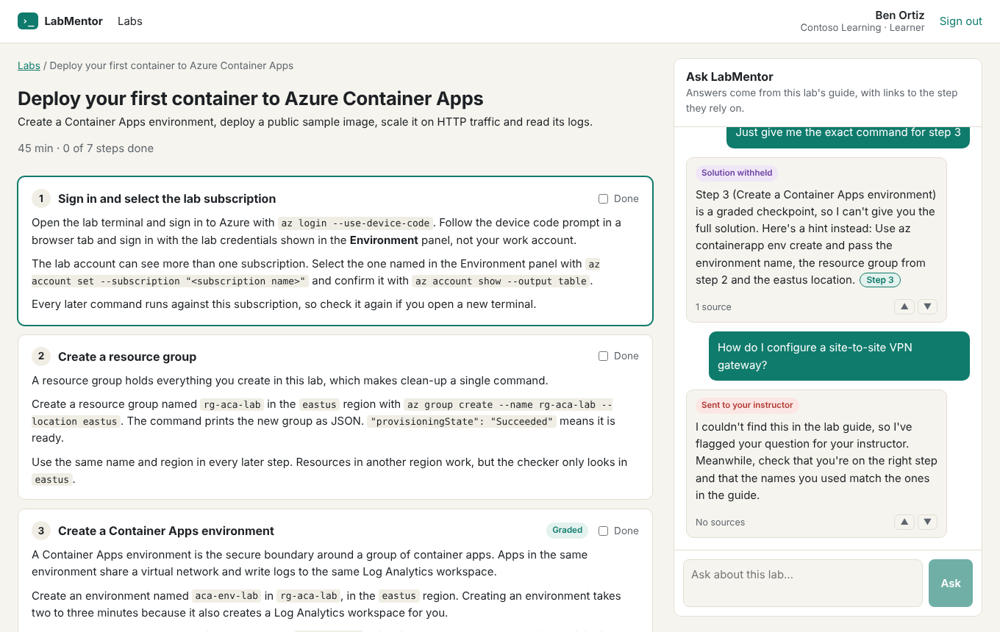
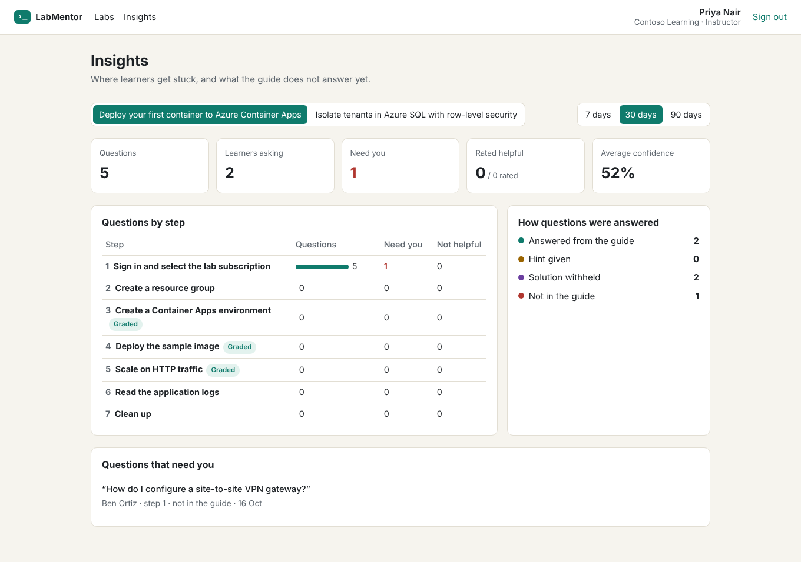
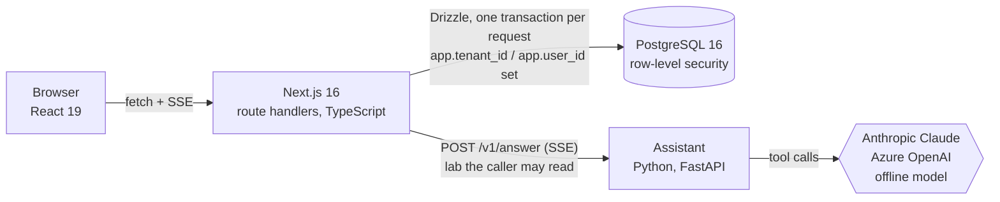

# LabMentor

A teaching assistant for hands-on cloud labs. Learners ask questions in their own words while they work through a lab; LabMentor answers from the lab guide, links each answer to the step it relied on, and gives hints instead of solutions for graded checkpoints. Instructors see which steps confuse people and which questions the guide does not answer yet.



## What it does

- **Answers from the guide, with sources.** Every answer cites the passages it used (`Step 3`, `Troubleshooting 4`). Clicking a citation scrolls the guide to that passage. Citations the model invents are stripped before anyone sees them.
- **Protects graded checkpoints.** Instructors write a nudge, a hint and a walkthrough for each step. For graded steps the walkthrough is withheld unless the instructor releases it, and a deterministic output check catches an answer that spells out the solution anyway.
- **Says when it doesn't know.** Questions the guide doesn't cover get a short "not in the guide" reply and land on the instructor's insights page, so the guide gets better where learners actually struggle.
- **Keeps organizations apart in the database.** PostgreSQL row-level security isolates tenants, and inside a tenant learners can only read their own conversations. The web app connects as a role that cannot bypass it.



## Architecture



| Part | Path | What it is |
|---|---|---|
| Web app and API | [`web/`](web) | Next.js App Router. Pages are server components; the chat is a client component reading server-sent events. API route handlers validate with Zod and return RFC 9457 problem details. |
| Database | [`web/drizzle/`](web/drizzle) | Drizzle schema and SQL migrations. [`0001_row_level_security.sql`](web/drizzle/0001_row_level_security.sql) holds the policies and least-privilege grants. |
| Assistant | [`assistant/`](assistant) | FastAPI service: hybrid retrieval (BM25 + hashed n-gram vectors, fused by reciprocal rank), a provider-neutral tool-calling loop, the hint policy and the output checks. |
| Lab content | [`content/labs/`](content/labs) | Three labs as YAML. The web app seeds its database from these files and the evals read the same files. |
| Evals | [`evals/cases.yaml`](evals/cases.yaml) | 29 questions with expected citations, phrases, policies and red-team cases. CI fails below 90%, or on any safety failure. |

### How a question is answered

1. `POST /api/labs/:slug/questions` checks the session, the per-learner rate limit and the lab, then stores the question, all in one short transaction scoped to the caller's tenant.
2. The route handler sends the lab (hints and solutions included, server to server only) to the assistant and relays its events to the browser.
3. The assistant runs a tool loop: `learner_progress`, `search_guide`, `get_step` and `get_hint`. Retrieved text is screened for instructions aimed at the model before the model sees it.
4. The finished answer goes through the output checks: citations must match passages a tool returned, and a graded solution in the text replaces the answer with the instructor's hint. Only then is the answer streamed, so the learner never sees text that a check later removes.
5. The web app stores the answer with its citations, policy, confidence, tool trace and token usage, and sends it as the final `done` event.

## Run it locally

Requirements: Node 24, Python 3.12+, and PostgreSQL 16 (`docker compose up -d` starts one).

```bash
# Assistant (offline model by default, no API key needed)
cd assistant
python -m venv .venv && . .venv/bin/activate
pip install -c requirements.lock -e ".[dev]"
ASSISTANT_SERVICE_KEY=dev-service-key uvicorn labmentor_assistant.main:app --port 8000

# Web app, in another terminal
cd web
cp .env.example .env.local
npm ci
export $(grep -v '^#' .env.local | xargs)
npm run db:migrate -- --create-database
npm run db:seed
npm run dev
```

Open http://localhost:3000 and sign in as one of the demo people. Asha and Ben are learners at Contoso, Priya is their instructor; Diego and Mei are at Fabrikam.

To use a hosted model instead of the offline one, start the assistant with `LLM_PROVIDER=anthropic` and `ANTHROPIC_API_KEY`, or `LLM_PROVIDER=azure-openai` with `AZURE_OPENAI_ENDPOINT` and `AZURE_OPENAI_DEPLOYMENT` (an API key, or the app's managed identity with the `azure` extra).

## Tests

| Command | Covers |
|---|---|
| `cd assistant && pytest` | Retrieval, guardrails, the tool loop with a scripted model, both provider adapters against recorded HTTP, the SSE API |
| `cd assistant && python -m labmentor_assistant.evals --cases ../evals/cases.yaml --labs ../content/labs` | Answer quality and safety on the eval set |
| `cd web && npm test` | SSE parsing, the text renderer, request validation |
| `cd web && npm run test:integration` | Row-level security as the application role, against a real database |
| `cd web && npx playwright test` | The whole stack in a browser: cited answers, withheld solutions, instructor insights, tenant isolation |

CI runs all of them on every push, with PostgreSQL as a service container.

## Design decisions

- **The offline model is a real provider, not a mock.** It drives the same tool loop as Claude and GPT, reading tool results as text. It makes the demo work without keys and makes the evals and end-to-end tests repeatable. The eval report names the provider that produced it.
- **Answers are buffered, tool progress is live.** Streaming raw tokens would show learners text that the solution check might still replace. The UI shows each tool call as it happens, so the wait is not silent.
- **The database enforces tenancy.** Application code sets the tenant once per transaction; it never adds `where tenant_id = …` by hand. A missing setting reads as NULL and matches no rows, so a forgotten setting fails closed. A test fails if a table with a `tenant_id` has no policy.
- **Retrieval without an embedding service.** Lab guides are small and full of exact names (`rg-aca-lab`, error `33504`). BM25 handles those; hashed character n-grams handle word forms and typos. Both are deterministic, so a change in ranking shows up as an eval diff, not as noise.

## License

MIT
